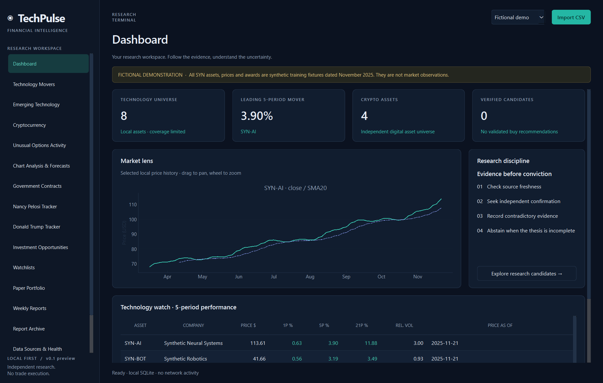

# TechPulse

Free, open-source, local-first **Windows desktop research preview** for technology equities, cryptocurrency and evidence-aware investment discovery. No paid API, AI subscription, brokerage link or trade execution is required.

**Version 0.1 is a research preview, not the completed 65-requirement production product.** See the requirement matrix and roadmap for exact coverage. Synthetic demonstration data is explicitly fictional and is never silently substituted for research data. No calibrated forecasts or proven investment edge are claimed.



On Windows, double-click **Start-TechPulse.cmd** with Python 3.12–3.14 installed. First setup downloads the free, hash-locked dependencies; subsequent offline research needs no API key. See [the user guide](docs/USER_GUIDE.md), [CSV schemas](docs/IMPORT_FORMATS.md) and [all 65 requirement statuses](docs/REQUIREMENTS.md).

## Install on Windows

```powershell
powershell -NoProfile -ExecutionPolicy Bypass -File .\packaging\install_windows.ps1
```

Installs a dedicated runtime and source under `%LOCALAPPDATA%\Programs\TechPulse`, creates Desktop/Start menu shortcuts and opens the native GUI. Python3.12–3.14 is required; no admin rights needed. Data stays in its separate existing app-data folder. This per-user source installer is distinct from the gated public bundled executable.

## Run from source

Python 3.12–3.14 and [uv](https://docs.astral.sh/uv/) are supported.

```powershell
uv sync --extra dev --frozen
uv run techpulse
```

Or `python -m pip install -e .` and `python -m techpulse`. Start offline; no account is needed. The GUI opens the fictional demonstration workspace. Use the workspace selector to switch to an initially empty personal research database, then import authorized CSV data. All network requests are explicit opt-in actions from Data Sources & Health. See docs/USER_GUIDE.md.

## Development

```powershell
uv run pytest
uv run ruff check .
uv run mypy src/techpulse
```

Read AGENTS.md and PROJECT_HANDOFF.md before editing. Shared instructions also support Claude, Gemini and Copilot. Local state lives in `%LOCALAPPDATA%\TechPulse` (or the platform equivalent); override with `TECHPULSE_DATA_DIR`. API credentials are environment variables only, never stored in the application database.

## Financial and data boundaries

All rankings are transparent research heuristics. Missing evidence reduces coverage; insufficient evidence produces **no candidate**. Scores are not probabilities. Pattern observations are exploratory and carry no predictive confidence. Disclosure-inspired analysis begins at publication, not transaction time. Contract ceilings are not guaranteed revenue. Calls and puts do not establish the trader's intent.

You are responsible for confirming permission to import, retain and export your data. The application ships no actual political disclosures or restricted market datasets. Automated political collection and public redistribution are disabled. Network provider coverage and terms are documented under docs/research/.

MIT project code. Qt/PySide6 and bundled libraries have separate licenses; see THIRD_PARTY_NOTICES.md. Binary builds are preview artifacts until clean-machine and release gates pass.

The first public release is source-only. `uv run python packaging/build_portable.py` builds a local Windows development artifact, which must pass the documented library-source, notice, security and clean-machine gates before public executable distribution.
